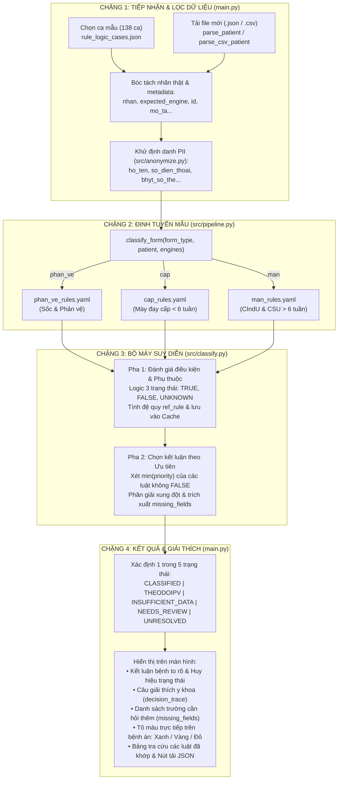

### BẢN TỔNG HỢP TOÀN BỘ QUY TRÌNH XỬ LÝ BỆNH ÁN
*(Vừa trực quan, dễ hiểu — Vừa đầy đủ mã nguồn và tên trường kỹ thuật)*

---

### Sơ đồ luồng 4 chặng từ đầu đến cuối

---

### Chặng 1: Nạp bệnh án và Làm sạch dữ liệu

* **Nơi thực hiện:** Giao diện [`main.py`](file:///c:/Users/Admin/rulebased_may_day/main.py) và module khử định danh [`src/anonymize.py`](file:///c:/Users/Admin/rulebased_may_day/src/anonymize.py).

#### 1. Cách bạn đưa bệnh án vào:
* **Cách 1 (Chọn ca có sẵn):** Chọn từ kho 138 ca bệnh án giả định tại [`data/synthetic/rule_logic_cases.json`](file:///c:/Users/Admin/rulebased_may_day/data/synthetic/rule_logic_cases.json).
* **Cách 2 (Tải file mới):** Upload file `.json` hoặc `.csv` từ máy tính. Hàm [`parse_csv_patient()`](file:///c:/Users/Admin/rulebased_may_day/main.py#L46-L69) sẽ tự động chuyển đổi kiểu dữ liệu cột chữ sang số hoặc `True`/`False`.

#### 2. Hệ thống bóc tách những gì để đảm bảo khách quan?
Hàm [`parse_patient()`](file:///c:/Users/Admin/rulebased_may_day/main.py#L97-L106) tại dòng 104–105 tự động **loại bỏ 6 trường sau** trước khi đưa dữ liệu vào suy luận:
1. `nhan`: Tên bệnh/đáp án thực tế (Ground Truth) để tránh "nhìn trộm".
2. `expected_engine`: Kết quả dự đoán mong đợi từ trước.
3. `workflow_gap`: Mã ghi chú kiểm thử (ví dụ: `F-01`, `F-02`...).
4. `id`: Mã định danh ca bệnh (ví dụ: `PV-01`, `BA_7642`).
5. `mo_ta`: Câu mô tả sơ lược ca bệnh.
6. `form_type`: Tên loại mẫu bệnh án.

Đồng thời, module [`src/anonymize.py`](file:///c:/Users/Admin/rulebased_may_day/src/anonymize.py#L40-L69) mã hóa các thông tin nhận dạng cá nhân:
* `ho_ten` $\rightarrow$ Che đệm (ví dụ: `Nguyễn Văn Anh` $\rightarrow$ `N*** Anh`).
* `so_dien_thoai` $\rightarrow$ Che giữa (ví dụ: `091****678`).
* `bhyt_so_the` & `ma_benh_nhan` $\rightarrow$ Băm mã SHA-256 (ví dụ: `PT_E3B0C44298FC1C14`).
* `dia_chi_so_nha_thon_pho` $\rightarrow$ Đổi thành `[MASKED_STREET]`.

---

### Chặng 2: Định tuyến vào đúng "Phòng chuyên khoa" (Routing)

* **Nơi thực hiện:** [`src/pipeline.py`](file:///c:/Users/Admin/rulebased_may_day/src/pipeline.py), hàm [`classify_form()`](file:///c:/Users/Admin/rulebased_may_day/src/pipeline.py#L22-L27).

Bệnh nhân được đưa vào đúng phòng khám bằng cách nạp tệp luật YAML tương ứng:
1. **Phòng Phản vệ & Sốc:** Nạp [`rules/phan_ve_rules.yaml`](file:///c:/Users/Admin/rulebased_may_day/rules/phan_ve_rules.yaml) (đánh giá nguy cơ tử vong).
2. **Phòng Mày đay cấp (< 6 tuần):** Nạp [`rules/cap_rules.yaml`](file:///c:/Users/Admin/rulebased_may_day/rules/cap_rules.yaml) (phân biệt cấp nặng hay cấp thường).
3. **Phòng Mày đay mạn (> 6 tuần):** Nạp [`rules/man_rules.yaml`](file:///c:/Users/Admin/rulebased_may_day/rules/man_rules.yaml) (phân biệt do kích thích CIndU hay tự phát CSU).

---

### Chặng 3: Bộ máy suy diễn Rule Engine (Trái tim của hệ thống)

* **Nơi thực hiện:** Lớp [`ClinicalRuleEngine`](file:///c:/Users/Admin/rulebased_may_day/src/classify.py#L12) tại [`src/classify.py`](file:///c:/Users/Admin/rulebased_may_day/src/classify.py).
* Quá trình suy luận chạy tuần tự qua **2 pha nghiêm ngặt**:

#### Pha 1: Đánh giá điều kiện & giải quyết phụ thuộc ([`_eval_rule`](file:///c:/Users/Admin/rulebased_may_day/src/classify.py#L230-L240), [`_eval_condition`](file:///c:/Users/Admin/rulebased_may_day/src/classify.py#L251-L395))
* **Nguyên tắc 3 trạng thái:** Không đoán mò. Mỗi điều kiện chỉ có thể là:
  - `TRUE` (Đúng - Đủ bằng chứng có triệu chứng).
  - `FALSE` (Sai - Đã kiểm tra và không có triệu chứng).
  - `UNKNOWN` (Chưa biết - Do thiếu số đo hoặc nhập sai kiểu. **Tuyệt đối không coi UNKNOWN là FALSE**).
* **Giải quyết phụ thuộc đệ quy (`ref_rule`):** Ví dụ luật Sốc phản vệ (`R-SOC`) cần biết luật Phản vệ (`R01-PV`, `R02-PV`, `R03-PV`) có đúng không; hệ thống sẽ tính luật Phản vệ trước, lưu kết quả vào bộ nhớ đệm `cache`, rồi mới quay lại tính tiếp `R-SOC`.

#### Pha 2: Phân giải ưu tiên và chốt kết luận ([`classify_patient`](file:///c:/Users/Admin/rulebased_may_day/src/classify.py#L397-L485))
Hệ thống tìm các luật thỏa mãn và chọn luật có **`priority` nhỏ nhất** (ưu tiên cao nhất - bệnh nguy hiểm được xử lý trước):
* **Ưu tiên 1:** Sốc phản vệ (`R-SOC`).
* **Ưu tiên 2:** Phản vệ (`R01-PV`, `R02-PV`, `R03-PV`).
* **Ưu tiên 4:** Mày đay cấp có dấu hiệu nặng (Ngứa nhiều, phù mạch thanh quản, lan $>50\%$ người).
* **Ưu tiên 5:** Mày đay cấp thông thường (chỉ khi loại trừ toàn bộ dấu hiệu nặng).
* **Ưu tiên 6 & 7:** Mày đay cảm ứng CIndU và mày đay tự phát CSU (phân loại theo test nhiệt/da vẽ nổi hoặc xét nghiệm kháng thể ELISA).

---

### Chặng 4: Trả kết quả cuối cùng trên màn hình

* **Nơi thực hiện:** [`main.py`](file:///c:/Users/Admin/rulebased_may_day/main.py#L386-L436).

Kết quả trả về cho người dùng gồm **4 thành phần rõ ràng**:

| Thành phần | Ý nghĩa hiển thị trên giao diện |
| :--- | :--- |
| **1. Kết luận chính** | Dòng chữ in hoa to rõ: `KẾT LUẬN: SỐC PHẢN VỆ`, `MÀY ĐAY CẤP CÓ DẤU HIỆU NẶNG`... |
| **2. Huy hiệu trạng thái** | Gồm 1 trong 5 trạng thái: • **ĐÃ PHÂN LOẠI (`CLASSIFIED`):** Đủ dữ liệu và ra bệnh chính xác. • **THEO DÕI PHẢN VỆ (`THEODOIPV`):** Đã loại trừ sốc/phản vệ nhưng cần theo dõi. • **CHƯA ĐỦ DỮ KIỆN (`INSUFFICIENT_DATA`):** Thiếu thông tin bắt buộc. • **CẦN RÀ SOÁT (`NEEDS_REVIEW`):** Sai kiểu dữ liệu (chữ/số) hoặc xung đột luật. • **CHƯA XÁC ĐỊNH (`UNRESOLVED`):** Bệnh án không khớp với bất kỳ luật nào. |
| **3. Giải thích lý do** | Đoạn tóm tắt y khoa (`decision_trace`): Nói rõ vì sao lại chẩn đoán như vậy (ví dụ: *"Thỏa mãn tiêu chuẩn phản vệ kèm tụt huyết áp nghiêm trọng theo độ tuổi"*). |
| **4. Danh sách cần bổ sung** | Nếu rơi vào `INSUFFICIENT_DATA`, hệ thống in danh sách gạch đầu dòng các trường cần hỏi thêm (`missing_fields`), ví dụ: *"Cần bổ sung: Huyết áp tâm thu thấp nhất"*. |

Đồng thời, bảng hồ sơ bệnh án bên cạnh được **tự động tô viền màu**:
* 🟩 **Màu xanh lá:** Triệu chứng khớp với tiêu chí bệnh (`matched`).
* 🟨 **Màu vàng:** Trường thông tin bị thiếu cần nhập thêm (`missing`).
* 🟥 **Màu đỏ:** Dữ liệu bị sai định dạng cần sửa lại (`review`).
